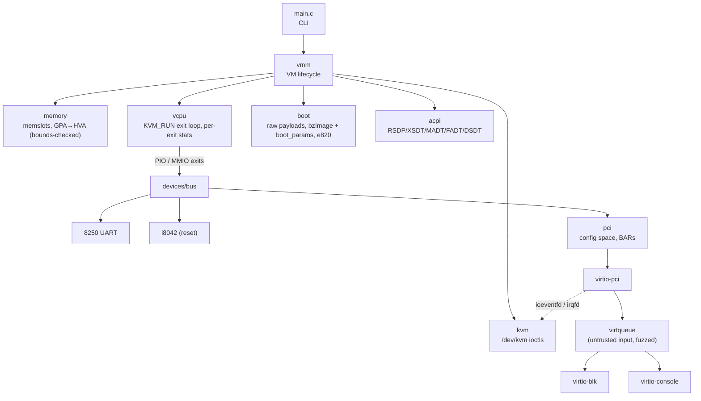

# minivmm

A small virtual machine monitor for x86-64 Linux hosts, written in C on top of
the KVM API: from a 16-bit "hello" payload to booting a real Linux kernel with
virtio devices, SMP and ACPI. Built to understand, measure and harden every
layer between `ioctl(KVM_RUN)` and a guest driver.

> Status: real/long-mode payloads and Linux boot to the test PID 1 work.
> Linux prints `minivmm-init: ready` and reboots through i8042; interactive
> input, PCI and virtio are planned in [docs/ROADMAP.md](docs/ROADMAP.md).

## Architecture



| Path | Contents |
|---|---|
| `src/` | The VMM. Everything except `main.c` is built into `libminivmm_core.a` so tests and fuzzers link the real code. |
| `guest/payloads/` | Flat-binary test guests (real mode, long mode). |
| `guest/kernel/minivmm.config` | Kconfig fragment for the minimal guest kernel. |
| `guest/init/` | Static PID 1 for the test initramfs. |
| `tests/unit/` | Host-only unit tests (TAP), no KVM required. |
| `tests/fuzz/` | libFuzzer targets for guest-controlled parsers + corpus. |
| `tests/integration/` | pytest: boot payloads / Linux under minivmm (needs `/dev/kvm`). |
| `tools/` | Python: VM-exit statistics, block I/O benchmark vs. QEMU. |
| `scripts/` | Fetch/build the pinned guest kernel and BusyBox initramfs; QEMU reference run. |

## Build

Requirements: Linux x86-64, GCC or Clang, Meson ≥ 1.3, Ninja, kernel UAPI
headers (`linux/kvm.h`). Running VMs needs `/dev/kvm` (user in group `kvm`).

```bash
meson setup build/debug
meson compile -C build/debug
meson test -C build/debug                 # unit tests + fuzz corpus replay

meson setup build/asan -Db_sanitize=address,undefined
meson setup build/release -Dbuildtype=release
CC=clang meson setup build/fuzz -Dfuzzing=true -Db_sanitize=address,undefined -Db_lundef=false
```

Guest kernel and initramfs (pinned versions and SHA256 in
[`scripts/versions.sh`](scripts/versions.sh)):

```bash
scripts/build-guest-kernel.sh   # needs flex, bison, bc, libelf-dev, libssl-dev
scripts/build-initramfs.sh
scripts/run-qemu-reference.sh   # same guest under QEMU, for comparison
```

Boot Linux with minivmm (inside the development VM, use
`build/vm-debug/src/minivmm`):

```bash
build/debug/src/minivmm --kernel guest/out/bzImage \
    --initrd guest/out/initramfs.cpio.gz --mem 128M
```

The default command line selects `ttyS0`, `/init` and `reboot=k`. Use
`--cmdline STR` to replace it. Supported images are x86-64 bzImages up to
128 MiB with boot protocol 2.12 or newer. The kernel's entire `init_size`
workspace, boot parameters, command line and initrd must fit below 1 GiB;
E820 can describe additional RAM above that. The UART supports TX and IRQ4,
with loopback RX for probing; stdin input is part of stage 4.

Integration tests:

```bash
uv run pytest
```

Development VM: minivmm can be built and run inside a QEMU VM (nested KVM),
with the repository shared over virtiofs at the same path. Needs `qemu-img`,
`xorriso`, `virtiofsd` and nested virtualization enabled in the host KVM module.

```bash
scripts/run-dev-vm.sh            # boot; the first boot provisions it via cloud-init
scripts/run-dev-vm.sh ssh        # from another terminal
```

Inside the VM `MINIVMM_BUILD_DIR` points at `build/vm-debug` and uv uses a
separate venv, so host and VM build trees do not clash:
`meson setup build/vm-debug && meson test -C build/vm-debug && uv run pytest`.

Docker (same packages as CI): `docker build -t minivmm .` and
`docker run --rm -it --device /dev/kvm -v "$PWD:/src" minivmm`.

## Fuzzing

Every parser of guest-controlled data has a libFuzzer target in
`tests/fuzz/`. Without `-Dfuzzing=true` the same targets are linked with a
standalone driver and replay `tests/fuzz/corpus/<target>/` as regular tests,
so every crash found once stays a regression test.

```bash
# libFuzzer writes new inputs into the FIRST directory: keep it outside git,
# commit only minimized crashers / interesting inputs to tests/fuzz/corpus/.
mkdir -p fuzz-work/virtqueue
./build/fuzz/tests/fuzz/fuzz_virtqueue -max_total_time=300 \
    fuzz-work/virtqueue tests/fuzz/corpus/virtqueue

# Stage 3 completion check (ASan + UBSan build above).
meson compile -C build/fuzz
mkdir -p fuzz-work/linux_loader
./build/fuzz/tests/fuzz/fuzz_linux_loader -max_total_time=600 \
    fuzz-work/linux_loader tests/fuzz/corpus/linux_loader
```

## Code quality

```bash
git ls-files '*.c' '*.h' | xargs clang-format --dry-run --Werror
run-clang-tidy.py -p build/debug -quiet "$(pwd)/(src|tests)/.*\.c$"
```

CI ([`.github/workflows/ci.yml`](.github/workflows/ci.yml)): GCC/Clang ×
plain/ASan+UBSan builds with `-Werror`, 60 s fuzzing per target, clang-format,
clang-tidy, ruff, and integration tests on a KVM-enabled runner.
